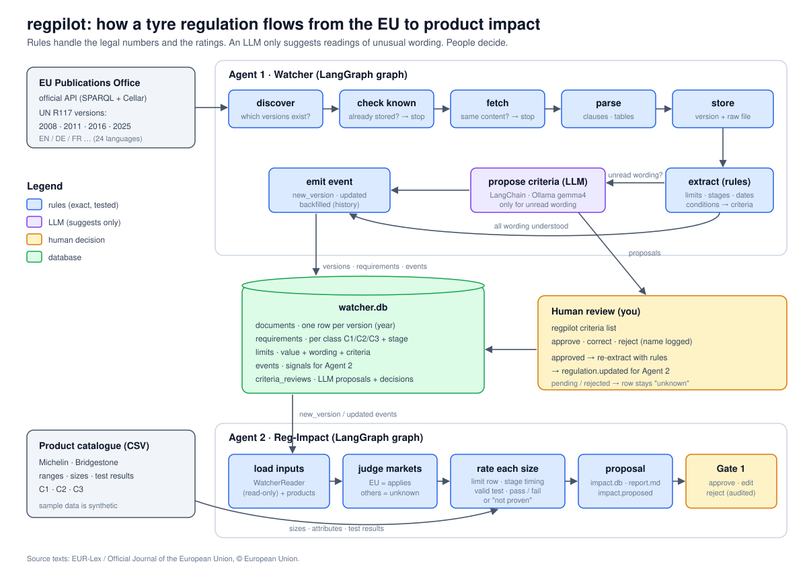

# regpilot: Tyre Regulation Watcher

**regpilot keeps track of tyre regulations so product teams don't have to.** It downloads
official EU/UN regulation texts (starting with **UN R117**: rolling noise, wet grip, rolling
resistance), turns them into exact, structured limits per tyre class and version, and tells the
next agent what changed, so the impact on products (e.g. Michelin / Bridgestone C1, C2, C3
ranges) can be assessed.



---

## What it does, in plain words

1. **Finds every published version** of a regulation through the EU Publications Office's
   official API: R117 has four (2008, 2011, 2016, 2025).
2. **Reads the legal text by rules**: clauses, limit tables, stages, dates and adjustments
   (for example "+1 dB(A) for extra load tyres"). Every value keeps the exact legal sentence it came from.
3. **Turns table wording into checkable criteria**: "load capacity index ≥ 87" becomes
   `load_index ≥ 87`, so a product size can be matched to the right limit automatically.
4. **Asks an LLM only when the wording is unusual**, and the LLM can only *suggest*. A person
   approves or rejects, and nothing the LLM says is used before that.
5. **Tells Agent 2 (Reg-Impact) what changed**: new version, updated version, or history, with
   a list of added, removed and changed requirements.
6. **Agent 2 rates every product size**: which markets the rule applies in, which limit row fits
   the size, whether the stage applies yet, and whether the latest valid test passes.
7. **A person decides at Gate 1**: approve, edit (with a reason) or reject the impact proposal.

Three rules hold throughout:

| | |
|---|---|
| 🔢 **Rules own the numbers** | Legal limits are never produced by an LLM. |
| ❓ **Unknown stays unknown** | Anything that can't be read with certainty is marked `unknown` and never guessed. |
| 🧑 **A person decides** | LLM suggestions and impact proposals need human approval. |

---

## Try it in 5 minutes

You need [uv](https://docs.astral.sh/uv/). [Ollama](https://ollama.com) is optional (for the LLM step).

```bash
uv sync                                         # install
uv run pytest                                   # 72 tests, offline, ~1 second

uv run regpilot discover R117                   # 4 versions: 2008, 2011, 2016, 2025
uv run regpilot watch R117                      # store the latest (2025)
uv run regpilot watch R117 --all-versions       # store the full history
uv run regpilot requirements R117               # the extracted limits
uv run regpilot diff R117 --from "42016X0812(01)" --to 42025X1453   # what changed 2016 → 2025
uv run regpilot limits R117 --brand michelin    # which limit applies to each product size

uv run regpilot impact                          # Agent 2: assess new watcher events → proposal
uv run regpilot gate1 list                      # proposals waiting for a decision
uv run regpilot gate1 show <id>                 # the report (also data/gate1/<id>/report.md)
uv run regpilot run R117                        # both agents in one go (impact only if something changed)
```

### Or click through it: the review app

```bash
uv run --extra ui regpilot app                  # opens http://localhost:8501
```

| Page | What you can do |
|---|---|
| 🏠 Overview | status at a glance; run the watcher / impact agents for any "as of" date |
| 📜 Regulation | versions, every limit with its criteria, what changed between versions, verbatim clauses |
| 🧠 Wording reviews | see the LLM's suggestions (with footnote and checks) and approve or reject them |
| 📊 Impact & Gate 1 | filter fails by brand / class, download CSV / report, edit · approve · reject, audit trail |
| 🛞 Products | the catalogue and which limit row applies to each size |

Decisions need your name in the sidebar and are written to the same audit trail as the CLI.
The app is optional: `--extra ui` adds Streamlit (~70 MB); the agents don't need it.

### What an impact proposal looks like (as of 2026-10-22, synthetic products)

| | |
|---|---|
| ❌ **Fail** | Bridgestone Turanza 6 225/45 R17 94W XL: rolling resistance 9.3 > 9.0 N/kN (Stage 3, **all C1 approvals since 7 Jul 2026**) |
| ❌ **Fail** | Bridgestone Duravis Van (C2) 8.7 > 8.5 and Duravis R002 (C3) 6.3 > 6.0: **new approvals now, all approvals from 1 Sep 2028** |
| ❓ **Not proven** | missing tests, an expired test (S02), an invalid test (S05), a test in the wrong unit (S11) |
| ⏭ **Skipped** | C1 wet grip Stage 1 and rolling resistance Stage 2: replaced by later stages for all approvals |
| 🌍 **Markets** | EU = applies (EU Official Journal) · India = unknown (never assumed) |

Then Gate 1:

```bash
uv run regpilot gate1 edit <id> --by YOUR_NAME --size S10 --requirement R117:6.3:C2:stage-3 \
    --verdict accepted_risk --reason "all-approvals date is 2028-09-01; reformulation planned"
uv run regpilot gate1 approve <id> --by YOUR_NAME --notes "reviewed with product team"
uv run regpilot gate1 reject <id> --by YOUR_NAME --notes "why"
```

Check a value against the official text: open the regulation on
[EUR-Lex](https://eur-lex.europa.eu/legal-content/EN/TXT/?uri=CELEX:42025X1453) and compare it with

```bash
uv run regpilot clause R117 6.1
```

Optional LLM step (needs Ollama with `gemma4:12b`, or set `REGPILOT_MODEL`):

```bash
uv run regpilot criteria propose R117           # LLM suggests readings of unusual wording
uv run regpilot criteria list                   # review the suggestions
uv run regpilot criteria approve 1 --by YOUR_NAME --criteria '{"category_of_use": "snow"}'
uv run regpilot criteria reject 1 --by YOUR_NAME
```

---

## Where things live: years, classes, brands

| You're looking for | Where it is |
|---|---|
| **Years / versions** (2008 … 2025) | `watcher.db` → `documents`, one row per version. "Current" = newest. |
| **When a rule starts to apply** (e.g. Stage 3 for C1 from 7 July 2026) | each requirement's `applicability` dates |
| **Tyre classes C1 / C2 / C3** | `tyre_class` column in `requirements` and `limits` |
| **Brands and ranges** (Michelin, Bridgestone) | **product data**, not regulation data: `sample_data/products/*.csv` (Agent 2's input) |

The regulation never mentions brands. It sets limits by class, width, load index, speed, and snow,
traction or run-flat flags. Agent 2 brings the two together.

---

## The database: `data/watcher.db`

Open it in VS Code with the free **SQLite Viewer** extension. Start with the view `current_limits`.

| Table | One row per | Example |
|---|---|---|
| `documents` | stored version | R117 · 42025X1453 · 2025-08-07 · eng |
| `sections` | clause, verbatim (tables as JSON) | `main:6.1.1` "For class C1 tyres …" |
| `requirements` | requirement (metric × class × stage) | `R117:6.3:C1:stage-3` |
| `limits` | **one limit value** | C1 · stage 3 · "load capacity index ≥ 87 / Tyres other than Run Flat…" · ≤ 9.0 · `{"load_index":{"min":87},"run_flat":false}` |
| `events` | signal for Agent 2 | `regulation.new_version`, +9 −9 ~6 vs 2016 |
| `criteria_reviews` | LLM suggestion + human decision | "Snow (*1)" → proposed |
| `runs` | watcher run | status, warnings |

Agent 2 keeps its own `data/impact.db` (`proposals`, `gate1_log`) and writes each proposal to
`data/gate1/<id>/` as `report.md`, `impact.csv`, `proposal.json` (+ `review.json` after a decision).

Views `current_documents`, `current_requirements` and `current_limits` always show the newest version.

```sql
SELECT tyre_class, stage, conditions, comparator, value
FROM current_limits
WHERE regulation = 'R117' AND metric = 'rolling_resistance_coefficient';
```

---

## All commands

| Command | What it does |
|---|---|
| `discover R117` | list published versions |
| `watch R117 [--as-of DATE] [--all-versions] [--language deu] [--force] [--llm]` | run the watcher |
| `requirements R117 [--json]` | extracted requirements of the current version |
| `diff R117 --from CELEX --to CELEX` | requirement changes between two versions |
| `clause R117 6.1` / `outline R117` / `search R117 "text"` | read the stored legal text |
| `limits R117 [--brand NAME]` | hand-off preview: applicable limit per product size (no pass/fail) |
| `impact [R117] [--as-of DATE] [--products DIR]` | Agent 2: no argument = react to new watcher events; with a code = re-assess the current version |
| `run R117 [--as-of DATE]` | watcher then impact (Orchestrator); impact only reacts to what the watcher reported |
| `gate1 list / show / edit / approve / reject` | human decision on impact proposals (audited) |
| `events` / `runs` | event list for Agent 2 / run log |
| `scan --since DATE` | every tyre-related EU publication (watchlist for new regulations) |
| `criteria propose / list / approve / reject` | the LLM suggestion and human review loop |
| `graph [--agent impact]` | an agent's LangGraph graph as a Mermaid diagram |
| `app` | the review app (needs `uv run --extra ui`) |

All commands start with `uv run regpilot`.

---

## Project map

```
src/regpilot/
├── core/
│   ├── models.py         contracts: Requirement, LimitRow, Criteria, AgentEvent, …
│   ├── orchestrator.py   Agent protocol (run(context) -> AgentResult) + Orchestrator
│   ├── cli.py            the commands above
│   └── net.py            HTTP with safe retries
├── watcher/              ── Agent 1 ──
│   ├── graph.py          ★ the LangGraph graph (start reading here)
│   ├── agent.py          WatcherAgent: the graph behind the Agent contract
│   ├── sources/          where documents come from (EUR-Lex / Cellar; add India etc. here)
│   ├── parsers/          Official Journal XHTML → clauses and tables
│   ├── requirements.py   rules: tables → limits, stages, adjustments, dates
│   ├── criteria.py       rules: wording → criteria ("Over 185 up to 245" → width 185–245)
│   ├── llm_criteria.py   the LLM step (LangChain): suggestions + checks
│   ├── diff.py           what changed between versions
│   ├── db.py             watcher.db
│   └── reader.py         ★ read-only API for Agent 2
└── impact/               ── Agent 2 ──
    ├── graph.py          ★ the LangGraph graph: load → judge markets → rate → proposal → store
    ├── agent.py          ImpactAgent: events in, impact.proposed out
    ├── judge.py          market applicability (rule-based; unknown is never assumed)
    ├── rating.py         limit row · stage timing · test selection · verdict
    ├── products.py       product CSVs → tyre attributes
    ├── models.py         SizeImpact, Proposal, verdicts
    ├── report.py         report.md · impact.csv · proposal.json
    ├── store.py          impact.db (proposals, gate1_log)
    └── gate1.py          approve / edit / reject with validation + audit
sample_data/products/     SYNTHETIC Michelin / Bridgestone catalogue
tests/                    72 offline tests; fixtures cut from the real regulation texts
app/regpilot_app.py       the review app (Streamlit)
docs/flow.svg             the diagram above
```

---

## How Agent 2 (Reg-Impact) decides

For every product size × requirement of its class, in a market where the regulation applies:

| Step | Rule |
|---|---|
| **Market** | EU Official Journal source + EU market = applies. Any other market = `unknown` (the range is listed as not assessed). |
| **Limit row** | the most specific row whose criteria match the size; at most one adjustment (e.g. +1 for severe snow). |
| **Timing** | `in_force` / `new_approvals_only` / `upcoming` from the transitional dates; a stage replaced by a later one for all approvals is skipped. |
| **Test** | latest test for that metric on or before the as-of date that is `valid` and not expired; same unit as the requirement. |
| **Verdict** | `pass` / `fail` (with margin), or why it can't be proven: `missing_test`, `expired_test`, `invalid_test`, `incomparable`, `unknown`, `ambiguous`, `not_defined`. |

It reads `watcher.db` only through `WatcherReader` (read-only) and never writes the product files.
`regulation.backfilled` events are ignored; when several events are pending for one regulation,
only the newest version is assessed. Proposal ids are deterministic, so re-running never duplicates.

Gate 1 (outside the graph): every action needs a name and goes to `gate1_log`; an edit overrides one
verdict and needs a reason (the agent's verdict is kept alongside it); approved or rejected proposals are final.

```python
from regpilot.core.orchestrator import Orchestrator
from regpilot.watcher.agent import WatcherAgent
from regpilot.impact.agent import ImpactAgent

ctx = Orchestrator([WatcherAgent(), ImpactAgent()]).run({"regulations": ["R117"]})
[e.type for e in ctx["events"]]     # e.g. ['regulation.new_version', 'impact.proposed']
```

<details>
<summary><b>Technical details</b> (events, ids, re-runs, parser lessons)</summary>

**Events.** `regulation.new_version` (newer publication or first seen), `regulation.updated` (same
publication changed, or a human-approved criteria review changed the reading,
`reason: criteria_reviewed`), `regulation.backfilled` (older version stored for history). The payload has
CELEX, document id, publication date, the previous version (its real predecessor), all
`requirement_ids`, `unknown_conditions`, and `changes` (added / removed / changed with notes).

**Stable ids.** `R117:6.3:C1:stage-2` = profiled clause + class + stage, the same across versions even
when the sub-clause is renumbered (6.3.2 in 2016, 6.3 in 2025).

**Safe re-runs without a checkpointer.** Stored versions aren't re-downloaded; `--force` compares
content hashes; a version stays `pending` until its event is written (a crash is redone next run);
event ids are deterministic, so they're never duplicated.

**Refusals.** No profile for a regulation, a language the rules weren't written for (e.g. German), or a
printed comparator that contradicts the profile: the text is stored and searchable, but no event is sent.

**The LLM step.** Runs only for wording the rules couldn't read. The prompt marks the legal text as
untrusted data. Output is a fixed schema; code checks that the evidence is verbatim and that every number
appears in the text. Failed calls aren't stored (retried next run). Small local models sometimes answer
with JSON text instead of a tool call; that's accepted only if it validates against the same schema.

**Parser lessons from real documents.** Two clause layouts (layout tables vs inline paragraphs);
merged cells (`rowspan`/`colspan`) expanded; the table of contents looks like clauses (stored as
`front`); annex words differ per language (`ANNEX`, `ANHANG`, …); adjustment sentences can sit inside
tables (2011); SPARQL regex has no `\b`; newer titles use a no-break space (`No\xa0117`); CELEX ids with
parentheses must be URL-encoded.

**Coverage.** R117 clauses 6.1 (rolling sound), 6.2 (wet grip, new state) and 6.3 (rolling resistance),
English text, versions 2008–2025. Remaining warnings are real: classes not yet regulated in older
versions, and the 2011 "Snow (*1)" rows whose footnote extends the limit to M+S-marked tyres (left for
a human to decide).

</details>

---

## Status and next steps

| Done | Next |
|---|---|
| Agent 1 watcher on LangGraph, R117 2008–2025 | More profiles: R117 6.4/6.5, R30, R54 |
| Rules for limits, stages, dates, adjustments, criteria | More sources: India AIS/BIS (`watcher/sources/`) |
| LLM suggestion + human review loop | Daily scheduled run + notification |
| Agent 2 on LangGraph: markets, limit selection, timing, tests, verdicts | Login / roles for reviewers (app uses a typed name) |
| Gate 1: approve / edit / reject, audited | Comparator (test methods) and Planner (test planning) agents |
| Review app (Streamlit) · 72 offline tests | |

---

**Data notes.** Regulation texts: EUR-Lex / Official Journal of the European Union, © European
Union (reuse under Commission Decision 2011/833/EU). The product catalogue in `sample_data/` is
**synthetic**: real product-family names with invented sizes and test values. It is not real
Michelin or Bridgestone data.
